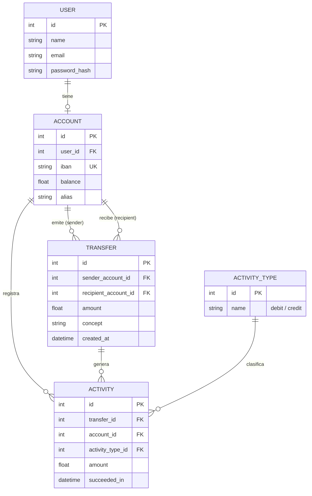

# ⚙️ Bank App API — Backend

API RESTful bancaria de alto rendimiento desarrollada con **FastAPI**, **SQLAlchemy ORM** y **Pydantic v2**. Proporciona la lógica de negocio, autenticación mediante tokens JWT, control transaccional de transferencias con doble apunte contable y persistencia de cuentas bancarias.

---

## 🚀 Características Principales

* **Autenticación con JWT**:
  * Emisión de JSON Web Tokens con algoritmo HS256 (`/auth/login`).
  * Hashing seguro de contraseñas mediante **Argon2** / `pwdlib`.
  * Middleware de autenticación y dependencias reutilizables (`get_current_user`).
* **Gestión de Cuentas**:
  * Consulta del perfil de usuario y de su cuenta bancaria vinculada (`/accounts/me`, `/user/me`).
  * Validación y búsqueda de cuentas destinatarias por su código **IBAN** (`/transfers/accounts/{iban}`).
* **Motor Transaccional de Transferencias**:
  * Ejecución de transferencias atómicas con control de saldo (`/transfers/`).
  * Prevención de transferencias hacia la propia cuenta o con importes negativos/cero.
  * Registro de doble entrada contable: genera automáticamente dos movimientos de actividad vinculados a la transferencia (apunte de **débito** para el emisor y de **crédito** para el receptor).
* **Historial de Actividad y Movimientos**:
  * Consulta de transferencias emitidas y recibidas.
  * Consulta paginada de movimientos de actividad (`/activity`) con parámetros `skip` y `limit`.
* **Inicialización y Siembra Automática (Seed)**:
  * Creación automática de esquemas y tablas en la base de datos al arrancar (`Base.metadata.create_all`).
  * Siembra idempotente de datos iniciales (`run_seed`): usuarios de prueba, tipos de actividad (`debit`, `credit`) y cuentas con saldo.
* **Documentación Interactiva Automática**:
  * Swagger UI y integrados y actualizados automáticamente según los esquemas de Pydantic.
* **Testing Unitario y Automatizado**:
  * El test unitario , mientras que el testing automatizado se realiza a través de GitHub Actions.

---

## 🛠️ Tecnologías y Dependencias

* **Python**: 3.10 / 3.14+
* **FastAPI (v0.141+)**: Framework web moderno y asíncrono para la construcción de APIs.
* **SQLAlchemy (v2.0+)**: ORM para modelado relacional y transacciones.
* **Pydantic (v2.13+)**: Validación de tipos y serialización de esquemas de entrada y salida.
* **Uvicorn (v0.53+)**: Servidor ASGI rápido para Python.
* **SQLite / PostgreSQL**: Persistencia relacional (configurado por defecto con `banco.db` en SQLite).
* **PyJWT & Argon2-cffi**: Generación de tokens de sesión y cifrado criptográfico de contraseñas.
* **Python-dotenv**: Carga de variables de entorno desde fichero `.env`.

---

## 🔀 Diagrama de la Base de Datos



---

## 📂 Estructura del Proyecto

```text
app-bank-backend/
├── .github/
│   └── workflows/
│       └── pytest.yml              # Pipeline de CI/CD: Automatización de pruebas y validación de regresiones en la nube
├── app/
│   ├── main.py                     # Punto de entrada de FastAPI, CORS y registro de routers
│   ├── core/
│   │   ├── auth.py                 # Dependencia para extracción y validación del token JWT
│   │   ├── database.py             # Configuración del motor SQLAlchemy y sesión DB
│   │   └── config.py               # Ajustes y configuración general
│   ├── controllers/
│   │   ├── auth_controller.py      # Lógica de autenticación y generación de JWT
│   │   ├── account_controller.py   # Consulta y lógica de cuentas de usuario
│   │   ├── transfer_controller.py  # Creación de transferencias y cálculo de balances
│   │   ├── activity_controller.py  # Consulta y formateo de actividades contables
│   │   └── user_controller.py      # Gestión de perfiles de usuario
│   ├── models/                     # Modelos ORM de SQLAlchemy (Tablas en base de datos)
│   │   ├── user_model.py           # Tabla users
│   │   ├── account_model.py        # Tabla accounts
│   │   ├── transfer_model.py       # Tabla transfers
│   │   ├── activity_model.py       # Tabla activity
│   │   └── activity_type_model.py  # Tabla activity_types (debit / credit)
│   ├── schemas/                    # Esquemas de validación y respuesta Pydantic v2
│   │   ├── user_schema.py          # UserLogin, TokenResponse, UserResponse
│   │   ├── account_schema.py       # AccountResponse
│   │   ├── transfer_schema.py      # TransferCreate, TransferResponse
│   │   └── activity_schema.py      # ActivityResponse
│   ├── routers/                    # Endpoints HTTP agrupados por dominio
│   │   ├── auth_router.py          # /auth
│   │   ├── account_router.py       # /accounts
│   │   ├── transfer_router.py      # /transfers
│   │   ├── activity_router.py      # /activity
│   │   └── user_router.py          # /user
│   ├── services/
│   │   └── security.py             # Utilidades de hashing y verificación de contraseñas
│   └── db/
│       └── seed.py                 # Datos de prueba iniciales (usuarios, cuentas, saldos)
├── tests/                          # Suite de QA (Pruebas Automatizadas de Integración y Regresión)
│   ├── test_auth.py                # Validación de emisión de tokens JWT, firma Bearer y manejo de credenciales inválidas
│   └── test_transfers.py           # Validación de lógica financiera: transacciones exitosas, control de sobregiros y bloqueo de auto-transferencias
├── banco.db                        # Base de datos SQLite (generada al arrancar)
├── requirements.txt                # Dependencias del entorno de Python
└── .env                            # Variables de entorno secretas (JWT key)
```

---

## ⚙️ Instalación y Puesta en Marcha

### 1. Clonar el repositorio
```bash
git clone https://github.com/App-Bank/app-bank-backend.git
cd app-bank-backend
```

### 2. Crear y activar el entorno virtual
* **En Windows (PowerShell):**
  ```powershell
  python -m venv venv
  .\venv\Scripts\Activate.ps1
  ```
* **En macOS / Linux:**
  ```bash
  python3 -m venv venv
  source venv/bin/activate
  ```

### 3. Instalar dependencias
```bash
pip install -r requirements.txt
```

### 4. Configurar variables de entorno
Crea un fichero `.env` en la raíz del proyecto (si no existe) con la clave secreta para firmar los tokens JWT:
```env
AUTH_SECRET_KEY=tu_clave_secreta_super_segura_jwt
```

### 5. Ejecución Local de la Suite Test
```bash
python -m pytest -v
```

### 6. Iniciar el servidor
```bash
python -m uvicorn app.main:app --host 127.0.0.1 --port 8000 --reload
```

El servidor estará escuchando en **`http://127.0.0.1:8000`**.

---

## 🧪 Control de Calidad y Pruebas Automatizadas (CI/CD)
El proyecto cuenta con una arquitectura de pruebas automatizadas mediante **Pytest** y **HTTPX** que valida el core del negocio de forma aislada. Para garantizar la inmutabilidad de los datos, la suite desvía las importaciones hacia una instancia descartable en memoria (`sqlite://`), evitando alterar la base de datos de desarrollo (`banco.db`).

**Escenarios Críticos Verificados**:
* **Integridad Financiera**: Doble asiento contable (débito/crédito), límites de sobregiro y restricciones de balance en transferencias.
* **Seguridad Criptográfica**: Flujo completo de login, firma de payloads y expiración de tokens JWT.

**Automatización en la Nube**:
A través de **GitHub Actions** (`.github/workflows/pytest.yml`), el backend ejecuta de forma autónoma la suite completa ante cada `push` o `pull_request` dirigido a las ramas `dev` y `main`, bloqueando el despliegue automático si se detecta alguna regresión en el código.

---

## 📖 Documentación Interactiva de la API

Una vez iniciado el servidor, puedes probar todos los endpoints interactivamente desde el navegador:

* **Swagger UI:** [http://127.0.0.1:8000/docs](http://127.0.0.1:8000/docs)

---

## 📋 Endpoints Principales

| Método | Endpoint | Descripción | Requiere Auth (Bearer) |
| :--- | :--- | :--- | :---: |
| `POST` | `/auth/login` | Inicia sesión y devuelve el token JWT | No |
| `GET` | `/user/me` | Devuelve los datos del usuario autenticado | Sí |
| `GET` | `/accounts/me` | Devuelve la cuenta y saldo del usuario actual | Sí |
| `GET` | `/transfers/accounts/{iban}` | Busca una cuenta por su código IBAN | Sí |
| `POST` | `/transfers/` | Realiza una transferencia hacia otra cuenta | Sí |
| `GET` | `/transfers/history` | Histórico de transferencias del usuario | Sí |
| `GET` | `/activity` | Lista de actividades (débitos/créditos) paginadas | Sí |

---

## 🔑 Credenciales de Prueba (Seed)

La base de datos se inicializa automáticamente con dos cuentas de prueba listas para operar:

| Nombre | Correo Electrónico | Contraseña | IBAN | Saldo Inicial |
| :--- | :--- | :--- | :--- | :--- |
| **User Uno** | `user1@banco.com` | `test1234` | `ES9121000418450200051332` | 1.000,00 € |
| **User Dos** | `user2@banco.com` | `test1234` | `ES9121000418450200051333` | 500,00 € |
